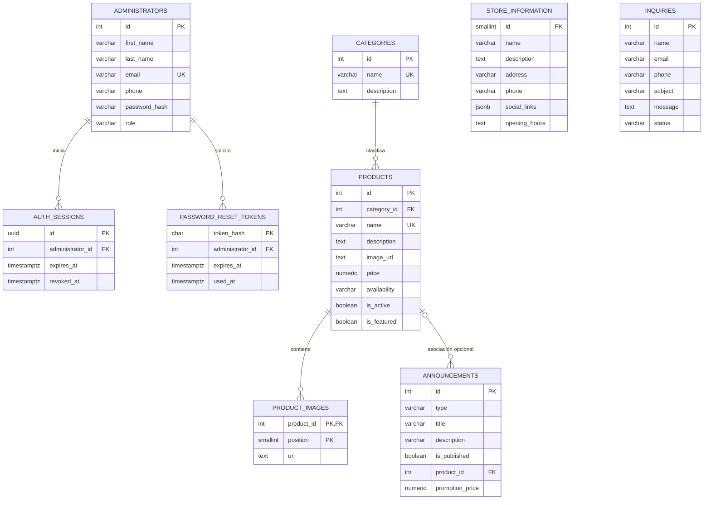

# Modelo de la base de datos

PostgreSQL es la fuente de persistencia. El servidor accede mediante consultas parametrizadas con `pg`; no utiliza ORM.

## Relaciones



`store_information` es una tabla de una sola fila: solamente permite el registro con `id = 1`.

## Galerías

`product_images` guarda una URL y una posición por fila. La clave compuesta `(product_id, position)` impide posiciones repetidas y permite leerlas en orden. Las posiciones se limitan a 0–9 y cada URL debe ser no vacía y tener hasta 2000 caracteres. La referencia al producto tiene `ON DELETE CASCADE`.

La API exige de una a diez URLs completas HTTP/HTTPS sin duplicados. `products.image_url` conserva la principal por compatibilidad y se actualiza junto con la galería dentro de una transacción. Las ediciones bloquean la fila del producto con `FOR UPDATE`; un fallo al guardar una imagen revierte también los demás cambios. Eliminar imágenes y ordenar se realiza enviando el arreglo final completo.

La migración 007 copia todas las imágenes anteriores a la posición 0 sin modificar los productos, incluidos los inactivos y destacados. El seed solamente incorpora la imagen inicial cuando el producto todavía no tiene galería; no reemplaza selecciones del administrador. La lectura de colecciones usa una subconsulta agregada para no duplicar productos en los listados.

## Promociones y novedades

`announcements` guarda promociones y novedades, en borrador por defecto. Una promoción puede vincular un producto y fijar un precio promocional. Un índice único parcial garantiza hasta una oferta publicada por producto y una restricción exige que el identificador del producto y el importe promocional se informen juntos. La clave foránea elimina las promociones vinculadas cuando se borra el producto.

Las escrituras de promociones vinculadas y los cambios de precio habitual bloquean la fila del producto antes de comprobar el importe. Así se conserva la relación entre ambos precios al editar y publicar en paralelo. El catálogo calcula el precio vigente a partir de la oferta publicada y la visibilidad del producto.

## Integridad

- Los correos de administradores son únicos sin distinguir mayúsculas y minúsculas.
- Los nombres de categorías y productos son únicos sin distinguir mayúsculas y minúsculas.
- Un producto siempre referencia una categoría existente.
- PostgreSQL impide eliminar categorías con productos asociados.
- Los precios no pueden ser negativos.
- `products.is_featured` es obligatorio y vale `false` por defecto; es independiente de `is_active`. Las rutas públicas exigen siempre que el producto esté activo. Un índice parcial facilita el listado de destacados activos por fecha e identificador.
- La disponibilidad se limita a `in_stock`, `out_of_stock` o `preorder`.
- El estado de una consulta se limita a `pending`, `read` o `answered`.
- Las contraseñas nunca se guardan en texto plano.
- Los tokens de recuperación se guardan mediante un resumen criptográfico SHA-256.
- Cerrar sesión o restablecer la contraseña revoca las sesiones correspondientes.

## Migraciones

Las migraciones se ejecutan en orden y se registran en `schema_migrations`:

1. `001_create_categories.sql`
2. `002_create_authentication.sql`
3. `003_create_store_and_inquiries.sql`
4. `004_create_products.sql`
5. `005_translate_seed_categories.sql`
6. `006_add_featured_products.sql`
7. `007_create_product_images.sql`
8. `008_create_announcements.sql`
9. `009_add_catalog_photos.sql`

El ejecutor usa un bloqueo asesor de PostgreSQL para evitar ejecuciones concurrentes.

Para la entrega también se incluye `database/create_database.sql`, que incorpora las nueve migraciones. Se ejecuta sobre una base vacía:

```bash
psql "$DATABASE_URL" -f database/create_database.sql
```

## Inspección manual

Con PostgreSQL iniciado mediante Homebrew:

```bash
psql -d gamer_store
```

Comandos útiles dentro de `psql`:

```sql
\dt

SELECT version, applied_at
FROM schema_migrations
ORDER BY version;

SELECT id, first_name, last_name, email, phone, role
FROM administrators
ORDER BY id;

SELECT id, administrator_id, expires_at, revoked_at
FROM auth_sessions
ORDER BY created_at DESC;

SELECT id, name, description
FROM categories
ORDER BY name;

SELECT
  products.id,
  products.name,
  categories.name AS category,
  products.price,
  products.availability,
  products.is_active,
  products.is_featured
FROM products
JOIN categories ON categories.id = products.category_id
ORDER BY products.id;

SELECT product_id, position, url
FROM product_images
ORDER BY product_id, position;

SELECT * FROM store_information;

SELECT id, name, email, subject, status, created_at
FROM inquiries
ORDER BY created_at DESC;
```

Salir con `\q`.
